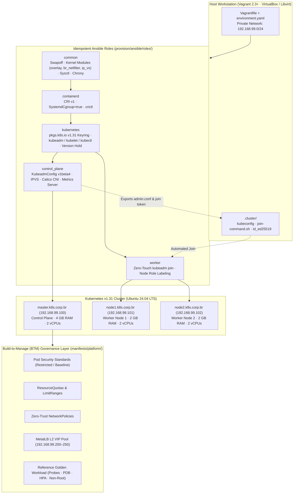

# Kubernetes Multi-Node Cluster & Platform Engineering Lab (`k8s-lab`)

[](https://github.com/eriktonon/k8s-lab/actions/workflows/ci.yml)
[-%23326CE5?style=flat-square&logo=kubernetes&logoColor=white)](https://kubernetes.io/)
[-%2357B2E6?style=flat-square&logo=containerd&logoColor=white)](https://containerd.io/)
[](provision/ansible/)
[](environment.yaml)

Automated, zero-touch multi-node **Kubernetes (`kubeadm` v1.31)** cluster lab provisioned with **Vagrant** and modular **Ansible roles**, pre-configured with **containerd CRI v1**, **IPVS `kube-proxy`**, **Calico CNI**, **Metrics Server**, and **Build-to-Manage (BTM)** platform governance manifests.

---

## 1. Architecture & Cluster Topology



### Node Specification (`environment.yaml`)

| Node | Role | FQDN | IP Address | vCPUs | RAM | Base Box |
|---|---|---|---|---|---|---|
| `master` | Control Plane | `master.k8s.corp.br` | `192.168.99.100` | 2 | 4096 MB | `bento/ubuntu-24.04` |
| `node1` | Worker Node | `node1.k8s.corp.br` | `192.168.99.101` | 2 | 2048 MB | `bento/ubuntu-24.04` |
| `node2` | Worker Node | `node2.k8s.corp.br` | `192.168.99.102` | 2 | 2048 MB | `bento/ubuntu-24.04` |

---

## 2. Technical Stack & Platform Engineering Decisions

- **CRI Runtime (`containerd`)**: Replaces legacy `dockershim` with native `containerd.io` configured with `SystemdCgroup = true` and `registry.k8s.io/pause:3.10`, aligned with kubelet's `systemd` cgroup driver.
- **Official CNCF Package Repositories (`pkgs.k8s.io`)**: Uses signed GPG keyrings (`/etc/apt/keyrings/kubernetes-apt-keyring.gpg`) for Kubernetes `v1.31` packages with `dpkg_selections: hold` to prevent unplanned drift during OS patching.
- **IPVS Service Proxying**: Loads kernel IPVS scheduling modules (`ip_vs`, `ip_vs_rr`, `ip_vs_wrr`, `ip_vs_sh`, `nf_conntrack`) and configures `KubeProxyConfiguration` in `ipvs` mode for deterministic $O(1)$ service routing.
- **Zero-Touch Worker Auto-Join**: The `control_plane` Ansible role exports the cluster `admin.conf` and a signed join script to `.cluster/` (gitignored), allowing `node1` and `node2` to join the cluster automatically during `vagrant up` without manual token copy-pasting.
- **Build-to-Manage (BTM) Golden Manifests**: Ships production-grade Kubernetes manifests in `manifests/platform/` enforcing Pod Security Standards (`restricted`), `ResourceQuota`, `LimitRange`, default-deny `NetworkPolicy`, `PodDisruptionBudget`, and `HorizontalPodAutoscaler`.

---

## 3. Repository Structure

```text
.
├── .github/workflows/ci.yml                  # Automated syntax & lint validation (Ruby, YAML, Ansible, ShellCheck)
├── Vagrantfile                               # Multi-provider (VirtualBox / Libvirt) declarative Vagrantfile
├── environment.yaml                          # Node topology, resource allocation, and network matrix
├── Makefile                                  # Developer Experience (DX) & Day-2 operational commands
├── startLab.sh                               # Zero-touch cluster bootstrap script
├── scripts/
│   └── verify-cluster.sh                     # 5-stage Build-to-Manage readiness verification gate
├── manifests/platform/
│   ├── 00-namespaces.yaml                    # Platform, Observability & Workloads namespaces with PSS labels
│   ├── 01-governance-quotas.yaml             # FinOps ResourceQuota & LimitRange guardrails
│   ├── 02-network-policies.yaml              # Zero-Trust default-deny ingress & DNS/namespace allowlist
│   ├── 03-metallb-l2.yaml                    # Bare-metal LoadBalancer L2 VIP pool (192.168.99.200-250)
│   └── 04-reference-workload.yaml            # Hardened non-root reference service (Probes, PDB, HPA)
└── provision/ansible/
    ├── ansible.cfg                           # Ansible runner configuration
    ├── site.yml                              # Unified cluster playbook
    ├── master.yaml                           # Control-plane entrypoint
    ├── nodes.yaml                            # Worker-node entrypoint
    ├── group_vars/all.yml                    # Version pins, CIDRs, kernel modules, and sysctl settings
    ├── inventory/hosts.yml                   # Static inventory for standalone Ansible execution
    └── roles/
        ├── common/                           # Swap disable, kernel modules, sysctl, chrony, /etc/hosts
        ├── containerd/                       # containerd.io CRI v1, SystemdCgroup=true, crictl
        ├── kubernetes/                       # pkgs.k8s.io GPG keyring, kubeadm/kubelet/kubectl
        ├── control_plane/                    # kubeadm init, Calico CNI, Metrics Server, token export
        └── worker/                           # Automated kubeadm join & worker node labeling
```

---

## 4. Quick Start (Zero-Touch Provisioning)

### Prerequisites
- [Vagrant](https://www.vagrantup.com/) `>= 2.3`
- [VirtualBox](https://www.virtualbox.org/) `>= 7.0` (or `vagrant-libvirt` for KVM)
- `kubectl` (optional on host; pre-installed inside all cluster nodes)

### 1. Bootstrap the Cluster

```bash
git clone https://github.com/eriktonon/k8s-lab.git
cd k8s-lab
make up
```

During `make up` (or `./startLab.sh`):
1. An internal Ed25519 SSH keypair is generated in `.cluster/id_ed25519`.
2. `master` initializes the Kubernetes `v1.31` control plane, installs **Calico CNI** + **Metrics Server**, and exports `.cluster/config` and `.cluster/join-command.sh`.
3. `node1` and `node2` automatically join the cluster and receive the `node-role.kubernetes.io/worker=worker` label.

### 2. Access the Cluster from Your Host

```bash
export KUBECONFIG="$(pwd)/.cluster/config"
kubectl get nodes -o wide
```

Or SSH directly into the control plane:

```bash
vagrant ssh master
kubectl get nodes -o wide
```

### 3. Apply Build-to-Manage Platform Governance & Verify Readiness

```bash
make apply-platform
make verify
```

---

## 5. Day-2 Operations & Runbook Commands

| Command | Action |
|---|---|
| `make up` | Provision VMs, bootstrap Kubernetes control plane, and auto-join workers |
| `make status` | Check Vagrant VM state and `kubectl get nodes -o wide` |
| `make verify` | Run the 5-stage Build-to-Manage readiness gate (`scripts/verify-cluster.sh`) |
| `make apply-platform` | Apply PSS namespaces, ResourceQuotas, NetworkPolicies, and reference workload |
| `make lint` | Run syntax checks on `Vagrantfile`, Ansible roles, and YAML manifests |
| `make halt` | Gracefully stop cluster VMs while preserving etcd state |
| `make destroy` | Tear down all VMs and purge `.cluster/` credentials |

---

## Author

**Erik Tonon** — *Head of Platform Engineering & Generative AI @ IBM Consulting | Ex-Associate Director at BTG Pactual | Founder @ EdgeSearch Labs*
- Website: [eriktonon.com](https://eriktonon.com)
- LinkedIn: [linkedin.com/in/erik-tonon](https://www.linkedin.com/in/erik-tonon/)
